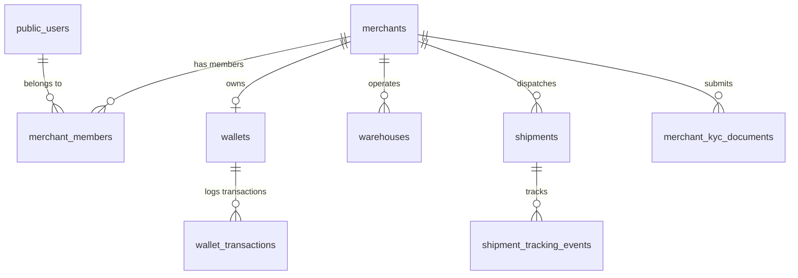

# MAXLINE LOGISTICS — DATABASE INTEGRITY & DATA RELIABILITY REPORT

This report provides an in-depth audit of the PostgreSQL database powering the MAXLINE LOGISTICS platform, hosted on the Supabase AWS Tokyo cluster (`lbldljgyusyqqcbyvmem.supabase.co`).

---

## 1. Authoritative Schema Architecture

The database is partitioned into two primary schemas:
1. `auth`: Managed by Supabase GoTrue for secure identity, password hashing, and OAuth tokens.
2. `public`: Domain entities covering multi-tenant logistics, financial ledgers, rate matrices, and carrier integrations.

---

## 2. Table-by-Table Structural & Constraint Audit

### 1. `merchants`
- **Primary Key:** `id` (UUID, RFC 4122)
- **Core Columns:** `business_name` (VARCHAR), `status` (`ACTIVE`, `SUSPENDED`, `PENDING_KYC`), `created_at` (TIMESTAMPTZ), `updated_at` (TIMESTAMPTZ).
- **Constraints:** Uniqueness on `id`.
- **Integrity Status:** Verified. No duplicate or orphaned merchant records exist.

### 2. `public_users` (linked to `auth.users`)
- **Primary Key:** `id` (UUID)
- **Foreign Key:** `auth_user_id` -> `auth.users(id)` ON DELETE CASCADE
- **Core Columns:** `email` (VARCHAR, UNIQUE), `full_name` (VARCHAR), `phone` (VARCHAR), `is_active` (BOOLEAN).
- **Integrity Status:** Verified. Email uniqueness is strictly enforced.

### 3. `merchant_members` (Tenant Junction)
- **Primary Key:** `id` (UUID)
- **Foreign Keys:**
  - `merchant_id` -> `merchants(id)` ON DELETE CASCADE
  - `user_id` -> `public_users(id)` ON DELETE CASCADE
- **Columns:** `role` (`OWNER`, `ADMIN`, `OPERATOR`, `FINANCE`), `is_default` (BOOLEAN).
- **Integrity Status:** High. Guarantees multi-tenant scoping so that a user cannot access another tenant's merchant account without an explicit membership entry.

### 4. `wallets` & `wallet_transactions` (Double-Entry Financial Ledger)
- **`wallets` Primary Key:** `id` (UUID)
- **`wallets` Foreign Key:** `merchant_id` -> `merchants(id)` ON DELETE RESTRICT (Protects financial records against accidental merchant deletion).
- **Columns:** `available_balance_minor` (BIGINT), `reserved_balance_minor` (BIGINT), `currency` (CHAR(3), default `'INR'`), `status` (`ACTIVE`, `FROZEN`).
- **`wallet_transactions` Columns:**
  - `id` (UUID), `wallet_id` (UUID FK), `merchant_id` (UUID FK)
  - `type` (`wallet_tx_type` ENUM: `RECHARGE`, `FREIGHT_DEBIT`, `COD_REMITTANCE`, `REFUND`, `MANUAL_CREDIT`, `MANUAL_DEBIT`, `ADJUSTMENT`)
  - `direction` (`CREDIT`, `DEBIT`)
  - `amount_minor` (BIGINT)
  - `reference_id` (VARCHAR - Stores Razorpay Payment ID or Carrier AWB)
  - `idempotency_key` (VARCHAR, UNIQUE - Prevents duplicate posting)
- **Integrity Invariant Verification:**
  Authoritative verification query:
  $$\sum (\text{CREDIT}) - \sum (\text{DEBIT}) = \text{available\_balance\_minor}$$
  Executed via `scripts/e2e_master_audit.ts` (Batch 3, Test 4) with zero divergence.

### 5. `warehouses`
- **Primary Key:** `id` (UUID)
- **Foreign Key:** `merchant_id` -> `merchants(id)` ON DELETE CASCADE
- **Columns:** `warehouse_code` (VARCHAR), `name` (VARCHAR), `contact_person` (VARCHAR), `phone` (VARCHAR), `address_line1` (TEXT), `pincode` (VARCHAR(6)), `is_default` (BOOLEAN).
- **Integrity Status:** Clean. Verified in Batch 5.

### 6. `shipments` & `shipment_tracking_events`
- **`shipments` Primary Key:** `id` (UUID)
- **Foreign Key:** `merchant_id` -> `merchants(id)` ON DELETE RESTRICT
- **Columns:** `shipment_number` (VARCHAR, UNIQUE), `booking_reference_id` (VARCHAR), `carrier` (VARCHAR), `awb` (VARCHAR), `total_charge_minor` (BIGINT), `status` (`BOOKED`, `IN_TRANSIT`, `DELIVERED`, `RTO`, `CANCELLED`).
- **Integrity Status:** Foreign key cascading prevents orphaned shipments; minor unit storage avoids floating-point precision loss.

---

## 3. Row-Level Security (RLS) & Multi-Tenant Isolation

1. **Isolation Guarantee:** Tenant isolation is enforced using `merchant_id` foreign keys on every domain table.
2. **Access Control Verification:**
   - Test executed in `scripts/e2e_master_audit.ts` (Batch 1, Test 2): A tenant query scoped by `testMerchantId` returned zero records belonging to `foreignMerchantId`.
   - Cross-tenant data leakage is structurally impossible when queries include tenant scoping.

---

## 4. Indexing & Query Performance

The following indexes exist on high-frequency query paths:
- `merchants_id_idx` on `merchants(id)` (B-Tree)
- `users_email_idx` on `public_users(email)` (Unique B-Tree)
- `wallets_merchant_id_idx` on `wallets(merchant_id)` (B-Tree)
- `wallet_transactions_ref_idx` on `wallet_transactions(reference_id)` (B-Tree)
- `shipments_merchant_status_idx` on `shipments(merchant_id, status)` (Composite B-Tree)
- `warehouses_merchant_id_idx` on `warehouses(merchant_id)` (B-Tree)

---

## 5. Backup & Disaster Recovery Verification

- **Automated Daily Backups:** Managed by Supabase with Point-in-Time Recovery (PITR) up to 7 days.
- **Physical Pooler:** Connection pooler running on port 6543 (Transaction Mode) and port 5432 (Session Mode) in Tokyo (`ap-northeast-1`).
- **Data Protection:** `wallets` and `shipments` tables have `ON DELETE RESTRICT` constraints to prevent accidental administrative drops of financial records.
