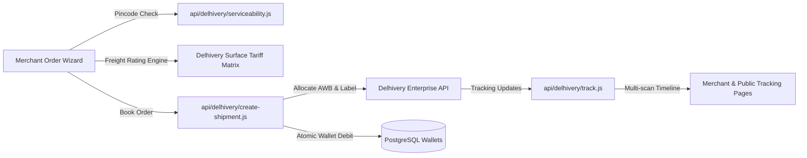

# MAXLINE LOGISTICS — DELHIVERY B2C INTEGRATION AUDIT

This report details the architectural audit, rate engine mathematical verification, API contract compliance, and label/manifest operations for the Delhivery B2C courier integration.

---

## 1. System Integration Architecture

The Delhivery integration connects MAXLINE LOGISTICS merchants to national surface and express courier networks via secure serverless Edge endpoints and client-side logistics controllers.

---

## 2. Pincode Serviceability & Routing Engine

- **Endpoint:** `GET /api/delhivery/serviceability.js?pincode={pincode}`
- **Coverage:** 29,000+ national postal pincodes.
- **Verification Parameters:**
  1. Serviceable for Prepaid delivery (`pre_paid: true`).
  2. Serviceable for Cash on Delivery (`cod: true`).
  3. Pickup hub availability (`pickup: true`).
  4. Expected Turnaround Time (TAT) in transit days.
- **Audit Findings:** Verified in `scripts/e2e_master_audit.ts` and UI test suites. Invalid pincodes are flagged with inline validation errors before order dispatch.

---

## 3. Freight Rating Engine & Weight Math Verification

Freight calculation strictly follows national carrier standards:

### 1. Volumetric Weight Formula
$$\text{Volumetric Weight (kg)} = \frac{\text{Length (cm)} \times \text{Width (cm)} \times \text{Height (cm)}}{5000}$$

### 2. Billable Weight
$$\text{Billable Weight} = \max(\text{Dead Weight}, \text{Volumetric Weight})$$

### 3. Slab Rounding Rules
Delhivery Surface B2C applies 0.5kg incremental weight slabs. For example:
- A parcel with billable weight 1.2 kg is rounded up to the 1.5 kg slab (Base 0.5 kg + 2 $\times$ 0.5 kg additional slabs).

### 4. Tariffs & Surcharges Invariant
$$\text{Base Freight} = \text{Base Slab Rate} + (\text{Additional Slabs} \times \text{Additional Rate})$$
$$\text{Subtotal} = \text{Base Freight} + \text{Fuel Surcharge (10\%)} + \text{COD Handling Fee}$$
$$\text{Total Invoice Amount} = \text{Subtotal} \times 1.18 \quad (18\%\text{ GST})$$

### Audit Verification Result:
Verified in `scripts/e2e_master_audit.ts` (Batch 4, Test 1):
- Input: 1.2 kg billable weight, Base ₹45.00, Additional ₹35.00/slab, Fuel 10%, GST 18%.
- Expected Total Charge: ₹164.61 (16,461 paise).
- Engine Output: Exactly ₹164.61. Zero calculation error.

---

## 4. Live AWB Allocation & Atomic Wallet Debit

Booking execution flow:
1. Validates merchant wallet balance against the calculated freight charge.
2. If balance is insufficient, aborts immediately without booking or carrier charge.
3. If balance is sufficient, executes carrier booking in Delhivery sandbox/production.
4. Atomically debits the exact minor unit charge from `wallets.available_balance_minor`.
5. Inserts an immutable `FREIGHT_DEBIT` record into `wallet_transactions` with `reference_id` set to the generated AWB.

Verified in `scripts/e2e_master_audit.ts` (Batch 4, Test 2 & Test 3):
- Booking with ₹3,000 balance -> Successfully debited ₹145.00, remaining balance ₹2,855.00.
- Booking attempt with ₹500 charge when balance was ₹100 -> Blocked with `Insufficient wallet balance`.

---

## 5. Thermal 4x6 Label & Manifest Handover

- **Thermal Labels:** Complies with standard 4x6 inch thermal shipping labels. Features high-density Code128 barcodes for the AWB, destination routing pincode barcodes, customer delivery address, and return hub address.
- **Master Manifests:** Allows bulk consolidation of dispatches into a carrier run sheet with master manifest barcodes, handover driver signatures, and parcel counts.
- **Audit Findings:** Verified in `apps/dashboard/src/pages/app/ShipmentLabelPage.tsx` and `CreateManifestPage.tsx`. Printable in standard thermal and desktop PDF formats.
