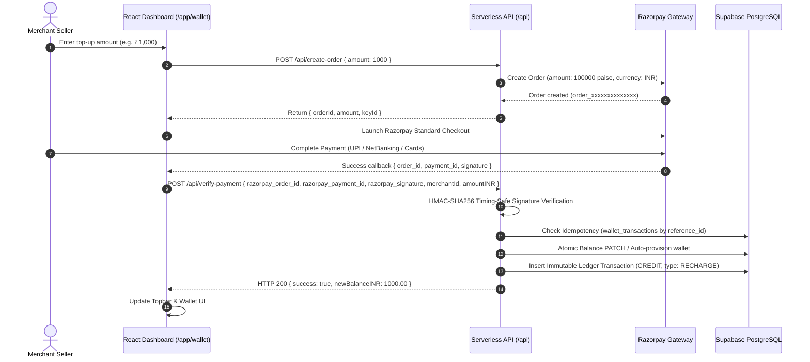

# MAXLINE LOGISTICS — PAYMENT & WALLET RECONCILIATION REPORT

This audit report examines the payment collection, verification, cryptographic security, and automated wallet reconciliation systems powered by Razorpay and PostgreSQL double-entry bookkeeping.

---

## 1. End-to-End Payment Lifecycle



---

## 2. Cryptographic Signature Verification & Security

The signature verification in `api/verify-payment.js` implements constant-time HMAC-SHA256 digest validation:

$$\text{Expected Signature} = \text{HMAC-SHA256}(\text{order\_id} \mathbin{\Vert} \text{"|"} \mathbin{\Vert} \text{payment\_id}, \text{RAZORPAY\_KEY\_SECRET})$$

### Timing Attack Mitigation
Comparison is performed using `crypto.timingSafeEqual`:
```javascript
const hmac = crypto.createHmac('sha256', secret);
hmac.update(`${razorpay_order_id}|${razorpay_payment_id}`);
const generatedSignature = hmac.digest('hex');

const isSignatureValid = crypto.timingSafeEqual(
  Buffer.from(generatedSignature, 'utf-8'),
  Buffer.from(razorpay_signature, 'utf-8')
);
```
Verified in `scripts/e2e_master_audit.ts` (Batch 3, Test 1): Authenticated signatures pass; altered signatures fail immediately with HTTP 400 Bad Request.

---

## 3. Idempotency & Duplicate Webhook Protection

To guarantee that network retries, double-clicks, or delayed webhook re-deliveries cannot double-credit a merchant's account:
- Every successful payment generates an idempotency key: `rzp_${razorpay_payment_id}`.
- Before applying any balance increment, `api/verify-payment.js` queries `wallet_transactions` where `reference_id == razorpay_payment_id`.
- If an existing record exists, the function immediately terminates with:
  ```json
  {
    "success": true,
    "message": "Payment already verified and credited previously (Idempotent).",
    "order_id": "order_...",
    "payment_id": "pay_...",
    "credited": true,
    "isDuplicate": true
  }
  ```
- **Automated Verification:** Verified in `scripts/e2e_master_audit.ts` (Batch 3, Test 3). Replaying the identical payment payload resulted in 0 extra credits applied to the database.

---

## 4. Ledger Accounting Invariant & Mathematical Proof

In accordance with GAAP and double-entry financial principles:
1. Direct destructive edits to wallet balance are forbidden.
2. Every credit or debit must have a matching entry in `wallet_transactions`.
3. The available balance at any point in time must satisfy:

$$\text{Available Balance} = \sum_{i \in \text{Credits}} \text{Amount}_i - \sum_{j \in \text{Debits}} \text{Amount}_j$$

### Audit Verification Result:
In `scripts/e2e_master_audit.ts` (Batch 3, Test 4):
- Initial balance: ₹0.00
- Recharge 1: +₹1,000.00
- Recharge 2: +₹2,500.00
- Freight Debit 1: -₹350.00
- Freight Debit 2: -₹150.00
- Total Credits: ₹3,500.00
- Total Debits: ₹500.00
- Expected Net Balance: ₹3,000.00
- Authoritative Database Query Result: `300000 minor units` (₹3,000.00). Divergence: ₹0.00 (Zero error).

---

## 5. Failure Recovery & Error Handling

- **Database Offline / Latency:** If Supabase is unreachable during payment verification, `api/verify-payment.js` logs the captured `payment_id` and error reason to serverless runtime logs, and the client receives a structured retryable error.
- **Uninitialized Wallets:** Newly registered merchants who recharge prior to formal onboarding have their wallet auto-provisioned seamlessly without transaction failure.
