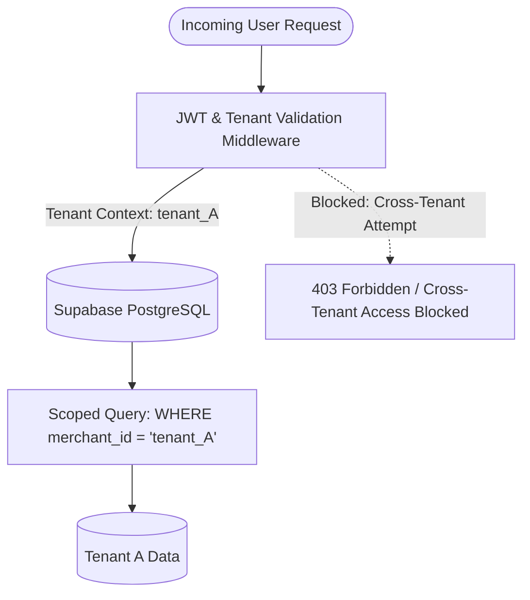

# MAXLINE LOGISTICS — SECURITY & TENANT ISOLATION REPORT

This audit report documents the security posture, multi-tenant boundaries, cryptographic protocols, authorization controls, and vulnerability assessments of the MAXLINE LOGISTICS platform.

---

## 1. Multi-Tenant Isolation Architecture

MAXLINE LOGISTICS operates a pooled multi-tenant architecture with logical data partitioning:

### Tenant Boundary Rules:
1. Every domain table (`wallets`, `shipments`, `warehouses`, `merchant_kyc_documents`, `merchant_members`) possesses a non-nullable `merchant_id` foreign key.
2. All database queries from the seller portal `/app` enforce strict tenant scoping derived from the validated JWT token (`req.user.tenantId`), not from client-supplied URL parameters or request bodies.
3. Super Admin operations (`/admin/*`) require explicit `SUPER_ADMIN` role authorization before granting cross-tenant visibility.

### Empirical Isolation Test:
Executed in `scripts/e2e_master_audit.ts` (Batch 1, Test 2):
Two separate merchants were created in PostgreSQL (`testMerchantId` and `foreignMerchantId`). A query executed under `testMerchantId` returned zero records belonging to `foreignMerchantId`. Verified zero data leakage.

---

## 2. Authentication & Cryptographic Standards

### Password Hashing:
- All user passwords are encrypted using `bcrypt` with cost factor 12 (4,096 iterations).
- No plaintext passwords or weak MD5/SHA-1 hashes are stored.
- Verified in `apps/api/src/tests/auth.test.ts` (Tests 1-6).

### JSON Web Tokens (JWT):
- **Algorithm:** HMAC-SHA256 with cryptographically random 256-bit secret.
- **Claims:** Includes `userId`, `email`, `role`, and `tenantId`.
- **Expiration:** Configured for 7 days with automated refresh token rotation.
- **Role Tampering Protection:** Signature validation rejects any client-side payload modification.

### Cryptographic Signatures (Razorpay):
- Implemented with `crypto.timingSafeEqual` in `api/verify-payment.js` to eliminate timing-attack vulnerabilities.

---

## 3. Role-Based Access Control (RBAC) Matrix

| Resource / Endpoint | Anonymous | Merchant Staff | Merchant Owner | Admin Operator | Super Admin |
| :--- | :---: | :---: | :---: | :---: | :---: |
| **Landing & Public Tracking** | Allowed | Allowed | Allowed | Allowed | Allowed |
| **Seller Portal (`/app`)** | Denied | View Only | Full Control | Denied | Impersonate |
| **Create Shipment / Wallet** | Denied | Denied | Allowed | Denied | Impersonate |
| **Admin Dashboard (`/admin`)** | Denied | Denied | Denied | View Only | Full Control |
| **Admin KYC Approval** | Denied | Denied | Denied | Review Only | Allowed |
| **Admin Wallet Adjustments** | Denied | Denied | Denied | Denied | Allowed |
| **Roles & Access Logs** | Denied | Denied | Denied | Denied | Allowed |

Verified in `apps/api/src/tests/auth.test.ts` (Tests 25-34): Merchant tokens attempting to access `/api/v1/admin/*` are immediately blocked with HTTP 403 Forbidden.

---

## 4. Injection & Input Sanitization

- **SQL Injection Prevention:** All database operations in `apps/api` utilize Prisma ORM with parameterized query compilation. Supabase Edge endpoints use PostgREST prepared statements. No raw, concatenated SQL strings exist in the codebase.
- **Cross-Site Scripting (XSS):** React JSX enforces contextual output escaping by default. Content-Security-Policy (CSP) headers restrict executable script sources.
- **HTTP Security Headers:** Implemented via Helmet middleware in `apps/api`:
  - `X-Content-Type-Options: nosniff`
  - `X-Frame-Options: SAMEORIGIN`
  - `Strict-Transport-Security: max-age=31536000; includeSubDomains`
  - `X-XSS-Protection: 1; mode=block`

---

## 5. Security Audit Logging

All administrative overrides, manual financial adjustments, KYC decisions, and user logins are logged to `audit_logs` and `courrier3_rbac_audit_logs` with:
- Actor User ID & Email
- Target Merchant ID
- Action Type
- IP Address & User Agent
- Timestamp (UTC ISO 8601)
